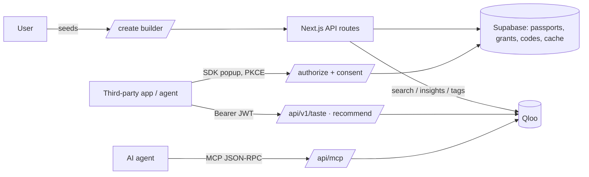

# TasteID — Sign in with Taste

> Every app starts you from zero. TasteID makes your taste travel with you — and you stay in control.

TasteID is a portable, user-owned, **anonymous** taste profile. You name 3–10 things you love; [Qloo](https://qloo.com)'s taste graph expands it across music, film & TV, dining, brands, books, podcasts, games and travel. Any app or AI agent can then use it — with your permission, per domain, revocable anytime — via an OAuth 2.0 + PKCE **"Sign in with Taste"** button. No name, no email, no history.

Built for the Qloo Agentic Hackathon. MIT licensed.

## 60-second judge path
1. `/create` — pick 3+ things you love → save the recovery key → see your passport at `/me`.
2. `/demo/reelhouse` — click **Sign in with Taste** → consent screen (untick domains) → left "Before" vs right "After" re-ranked list with a *why* on each item. Try `/demo/forkful` (city picker) and `/demo/threadline`.
3. `/agent` — same prompt to a plain AI and an AI with your TasteID; expand the ⚙ tool-call chips.
4. `/me/connections` — see each app, toggle scopes, **Revoke** → the app's token returns 401 instantly.
5. `/developers` — 3-line integration, live console, MCP endpoint.

## Why it needs Qloo
| Qloo call | Where | Why |
|---|---|---|
| `GET /search` (`types=urn:entity:*`) | builder, agent `search_entities` | resolve names → entity IDs |
| `GET /v2/insights` `filter.type=urn:entity:<type>` + `signal.interests.entities` | profile build, `/api/v1/recommend` | cross-domain expansion of seeds |
| …+ `filter.results.entities` | `/api/v1/recommend` with `candidates` | re-rank **the app's own catalog** against the user's taste (the cold-start fix) |
| …+ `filter.location.query` | Forkful, dining | city-aware places |
| …+ `feature.explainability=true` | "why" lines, agent `explain` | transparent recommendations |
| `filter.type=urn:tag` | taste DNA / archetype | the user's top tags |
| `filter.type=urn:demographics` | passport metadata | age/gender skew of the taste |

All Qloo calls are server-side; responses are cached 24h in Supabase (`qloo_cache`). Unsupported params are never sent (per-`filter.type` allowlist in `lib/qloo/client.ts`). **No Qloo response data is committed to this repo**; demo catalogs are plain title lists in `data/catalogs/*.titles.json`, resolved to Qloo entities at runtime.

## Architecture


## Local setup
```bash
npm install
cp .env.example .env.local   # fill values; leave QLOO_API_KEY empty to run in mock mode
npm run dev
```
Without Supabase env vars the app uses a local JSON store (`.data/`) so it runs offline; **production needs Supabase**: paste `supabase/schema.sql` into the Supabase SQL editor.

| Var | Purpose |
|---|---|
| `QLOO_API_KEY`, `QLOO_BASE_URL`, `QLOO_MOCK` | Qloo access (`QLOO_MOCK=true` or empty key → mock data, badge shown in header) |
| `NEXT_PUBLIC_SUPABASE_URL`, `SUPABASE_SERVICE_ROLE_KEY` | Postgres (server-side only) |
| `LLM_API_KEY`, `LLM_BASE_URL`, `LLM_MODEL` | any OpenAI-compatible provider for the agent playground + archetype (templated fallback if `LLM_API_KEY` is empty). Works with Gemini's OpenAI-compatible endpoint or Groq (`https://api.groq.com/openai/v1`) by changing just these three vars |
| `JWT_SECRET` | signs sessions + access tokens (64+ random chars) |
| `NEXT_PUBLIC_APP_URL` | public origin |

## Going live
Add `QLOO_API_KEY` and `LLM_API_KEY` / `LLM_BASE_URL` / `LLM_MODEL` to `.env.local`, then run:
```bash
bash scripts/go-live.sh
```
It sets `QLOO_MOCK=false`, runs `verify-qloo.mjs`, pushes all env vars to Vercel production, redeploys, and runs `smoke.mjs` against production with Qloo assertions on. It exits loudly on any failure.

### Manual steps (what the script automates)
1. Set `QLOO_API_KEY=<key>` and `QLOO_MOCK=false` (locally in `.env.local` and on Vercel).
2. Run `node scripts/verify-qloo.mjs` — prints a status table (writes no files). For any non-200 row, set the matching flag to `false` in `lib/qloo/capabilities.ts`.
3. Redeploy (`vercel --prod`) and run `node scripts/smoke.mjs https://<your-app>`.

**Never submit with mock mode on** (the header shows "Demo data — Qloo key pending" while it is).

## Security notes
OAuth code flow with mandatory S256 PKCE, single-use 10-minute codes, 1-hour JWT access tokens bound to a grant; every API call re-checks the grant is not revoked and intersects scopes live. Recovery keys are stored only as SHA-256 hashes. Sessions are httpOnly cookies.

## License
MIT — see [LICENSE](LICENSE).
